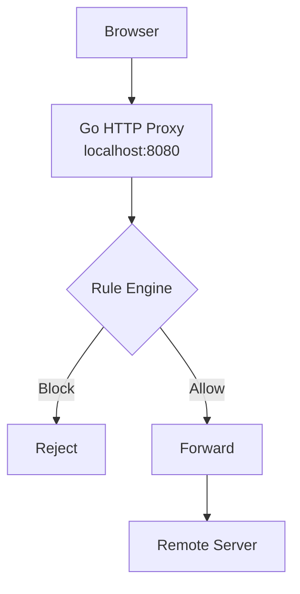

# Project plan: Local macOS Host Filter

**Goal:** Build a local proxy that blocks requests to specific hosts, tracks browsing attempts per session, and helps you understand networking and operating-system internals.

**Language:** Go
**Platform:** macOS
**Scope:** Browser traffic only
**Approach:** Implement the networking core yourself, using AI for design reviews, debugging, and feedback.

The project begins with the explicit proxy, then progresses through concurrency, DNS filtering, and eventually operating-system networking. The TCP and HTTP fundamentals are assumed knowledge and can be revisited only when a concrete implementation issue calls for it.

## Phase 1 — Build the explicit HTTP proxy

**Goal:** Forward permitted requests and block prohibited hosts.

Configure your browser to use your local proxy.

Architecture:



Implement:

1. Accept incoming browser connections.
2. Parse HTTP requests.
3. Extract and normalize destination hostnames.
4. Evaluate blocking rules.
5. Reject blocked requests.
6. Forward permitted requests to their destinations.
7. Log the decision.

Start with a hardcoded blocklist:

```text
youtube.com
reddit.com
news.example.com
```

Then move the rules into a configuration file.

### Add HTTPS support

HTTPS requests through an explicit HTTP proxy typically begin with:

```http
CONNECT example.com:443 HTTP/1.1
Host: example.com:443
```

Your proxy can inspect the hostname and reject blocked connections without decrypting HTTPS traffic.

For permitted connections, establish a TCP connection to the destination and tunnel bytes between the browser and server.

Study:

- HTTP `CONNECT`.
- TCP bidirectional copying.
- Connection closure and half-closes.
- DNS resolution.
- Network timeouts and errors.

**Completion criterion:** Your browser can access permitted websites through the proxy but cannot connect to blocked hostnames.

## Phase 2 — Implement session-based statistics

**Goal:** Track attempts to access each hostname during a proxy session.

Define a session as the period between starting and stopping the proxy.

Initially, keep all statistics in memory. No database is necessary.

### Metrics

| Metric | Definition |
|---|---|
| `attempts` | HTTP requests or HTTPS tunnel-establishment attempts received |
| `blocked` | Attempts rejected by blocking rules |
| `allowed` | Attempts permitted by blocking rules |
| `forwarded` | Requests or tunnels successfully established upstream |
| `failed` | Attempts that fail due to proxy or network errors |

Keep rule decisions separate from forwarding outcomes. An allowed request can still fail because the destination is unavailable.

### Per-host statistics

Conceptually, your data structure could look like this:

```go
type HostStats struct {
    Attempts  uint64
    Blocked   uint64
    Allowed   uint64
    Forwarded uint64
    Failed    uint64
}
```

You could aggregate these using a map keyed by normalized hostname.

For example:

```text
Session started: 10:00:00

youtube.com
  Attempts: 42
  Blocked:  42

reddit.com
  Attempts: 18
  Blocked:  12
  Allowed:   6

example.com
  Attempts: 25
  Blocked:   0
  Allowed:  25
```

These numbers are illustrative.

### Concurrency considerations

Because the proxy will handle concurrent connections, multiple goroutines may update the same counters.

Implement:

- A mutex-protected statistics collector.
- Consistent snapshots for displaying statistics.
- A summary printed when the proxy shuts down.
- Tests that verify counter behavior under concurrent access.

Run:

```bash
go test -race ./...
```

**Completion criterion:** The proxy reports accurate per-host statistics throughout a session without data races.

## Phase 3 — Improve the architecture

**Goal:** Make the code maintainable without hiding the underlying networking behavior.

Separate the project into three main components:

| Component | Responsibility |
|---|---|
| `Proxy` | Accept connections, handle requests, forward permitted traffic |
| `RuleEngine` | Normalize hostnames and decide whether to block them |
| `StatsCollector` | Record decisions and outcomes |

You can organize these into separate packages when their boundaries become clear. Avoid creating abstractions before you understand why they are needed.

Next, implement:

- Exact hostname matching.
- Optional subdomain matching.
- Configuration reloads.
- Structured logging.
- Graceful shutdown.
- Timeouts and connection limits.
- Automated tests for hostname-matching edge cases.

Be careful with domain matching: blocking `example.com` should not accidentally block `notexample.com`.

**Completion criterion:** You can change the rules, inspect the statistics, and troubleshoot failures without modifying unrelated components.

## Phase 4 — Explore DNS filtering

**Goal:** Understand how DNS-based blocking differs from HTTP proxying.

Build a small local DNS filtering service.

It should:

1. Receive DNS queries.
2. Extract the queried hostname.
3. Apply blocking rules.
4. Reject blocked queries or return a configured sinkhole response.
5. Forward permitted queries to an upstream resolver.
6. Record blocked queries.

Compare the results with your HTTP proxy.

| Capability | DNS filter | HTTP proxy |
|---|---|---|
| Block hostnames | Yes | Yes |
| Distinguish URL paths | No | Only when visible to the proxy |
| Track DNS queries | Yes | Not inherently |
| Inspect HTTPS paths without TLS interception | No | No |
| Require browser proxy configuration | No, if browser uses the configured resolver | Yes, for this explicit-proxy design |

Browser DNS-over-HTTPS and other networking behaviors can affect DNS filtering, so test them explicitly.

**Completion criterion:** You can explain which requests each mechanism sees and why the results sometimes differ.

## Phase 5 — Explore OS-level networking

**Goal:** Investigate how to enforce filtering without explicitly configuring a browser proxy.

At this point, study macOS Network Extension APIs.

Explore:

- DNS proxies.
- Content filters.
- Transparent proxies.
- Network flow management.
- System-extension permissions and entitlements.

This is a separate, more advanced milestone. Keep the core filtering rules and statistics logic independent of macOS-specific integration.

**Completion criterion:** You understand what your explicit proxy cannot intercept and can explain what additional operating-system facilities would be required.

---

## How to work through the project

Since the objective is learning, use the following workflow for every phase.

### 1. Design

Write down the component's responsibilities, expected behavior, and failure modes. Ask AI to critique the design rather than generate the implementation.

### 2. Implement

Write the important networking code yourself. Use official documentation and Go's standard library.

### 3. Test

Write tests for expected behavior and edge cases. Reproduce failures before attempting to fix them.

### 4. Review

Use AI to identify potential race conditions, protocol violations, missing edge cases, and incorrect assumptions.

### 5. Explain

Before moving on, explain how the component works, which operating-system services it relies on, and what happens when something fails.

You do not need to write every line manually. Focus your effort on the parts that develop your understanding of networking and systems programming.

## Recommended order of execution

| Milestone | Deliverable |
|---|---|
| 1 | Proxy that blocks matching HTTP requests |
| 2 | HTTPS `CONNECT` tunneling |
| 3 | In-memory per-host session statistics |
| 4 | Improved rules, logging, concurrency, and tests |
| 5 | Local DNS filter |
| 6 | Optional macOS system-level integration |
| 7 | Optional Rust reimplementation |

**Start with Milestone 1.** Do not implement the entire application in one pass.

One final recommendation: stick with Go for the initial implementation. Once you have a working proxy and understand its networking behavior, reimplementing the core in Rust will give you a meaningful opportunity to compare ownership, error handling, and concurrency models rather than learning those concepts in isolation.
